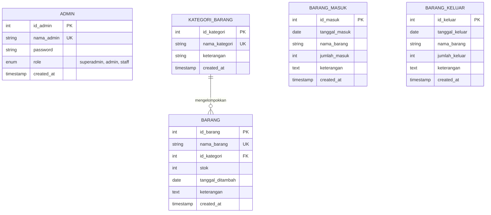

# 📦 SI-BARANG - Sistem Informasi Inventaris Barang

[](https://www.php.net/)
[](https://www.mysql.com/)
[]()
[]()
[]()

**SI-BARANG** adalah aplikasi web manajemen inventaris barang dan aset yang dirancang untuk mengelola master data barang, pencatatan transaksi barang masuk & keluar dengan kalkulasi stok otomatis, serta laporan rekapitulasi arus stok barang siap cetak.

Aplikasi ini dibangun menggunakan arsitektur **Clean Native PHP** yang ringan, aman, terstruktur rapi, dan mudah dideploy tanpa memerlukan framework eksternal yang kompleks.

---


## 🌐 Live Demo

**Try SI-BARANG online:** [Open Demo Website](https://faldesk.freedev.app/projects/sibarang/login.php)

Explore the inventory management system, including item management, incoming and outgoing stock transactions, and inventory reports.

> This is a portfolio demo. Please use the demo account or Quick Login feature provided on the login page.


## 🌟 Fitur Unggulan

- 📊 **Dashboard Ringkasan Metrik**: Statistik total master barang, volume barang masuk bulan ini, dan barang keluar bulan ini secara real-time.
- 🔐 **Multi-Level Role Based Access Control (RBAC)**:
  - **Superadmin**: Akses penuh seluruh sistem, manajemen akun admin & superadmin.
  - **Admin**: Manajemen master barang, kategori, transaksi, laporan, dan pengelolaan akun staf.
  - **Staff**: Operasional pencatatan barang masuk & keluar serta pengaturan profil mandiri.
- 🗂️ **Master Kategori & Data Barang**: Manajemen kategori dengan pengalihan otomatis jika kategori dihapus, serta pelacakan stok barang.
- 📥 **Transaksi Barang Masuk & 📤 Barang Keluar**: Validasi stok real-time, pencegahan stok minus (*insufficient stock guard*), dan fitur *atomic transaction rollback* saat pembatalan transaksi.
- 📋 **Laporan & Rekapitulasi Periode**: Filter periode fleksibel yang otomatis menghitung posisi **Stok Awal**, **Masuk**, **Keluar**, dan **Stok Akhir**.
- 🖨️ **Dokumen Siap Cetak (A4 Print-Ready)**: Layout cetak resmi untuk Daftar Master Barang, Transaksi Masuk, Transaksi Keluar, dan Laporan Rekapitulasi Stok.
- 🛡️ **Keamanan Berlapis**:
  - Proteksi **CSRF (Cross-Site Request Forgery)** pada seluruh mutasi data POST.
  - Hashing password terenkripsi standar industri dengan **Bcrypt** (`password_hash()`).
  - Pencegahan **SQL Injection** menggunakan *Prepared Statements* (MySQLi parameter binding).
  - Pencegahan **XSS (Cross-Site Scripting)** melalui sanitasi output terpusat.
  - Konfigurasi terisolasi menggunakan variabel lingkungan [`.env`](.env).

---

## 🏗️ Diagram Relasi Database (ERD)



---

## 👥 Matriks Hak Akses Pengguna

| Modul / Fitur | Superadmin 🔐 | Admin 👤 | Staff 📋 |
| :--- | :---: | :---: | :---: |
| **Dashboard Overview** | ✅ | ✅ | ✅ |
| **Master Kategori Barang** | ✅ | ✅ | ✅ |
| **Master Data Barang** | ✅ | ✅ | ✅ |
| **Pencatatan Barang Masuk** | ✅ | ✅ | ✅ |
| **Pencatatan Barang Keluar** | ✅ | ✅ | ✅ |
| **Laporan & Cetak Rekap** | ✅ | ✅ | ✅ |
| **Manajemen Pengguna (Admin & Staff)** | ✅ | ✅ *(Staff only)* | ❌ |
| **Manajemen Superadmin** | ✅ | ❌ | ❌ |
| **Profil Saya** | ✅ *(via Admin Menu)* | ✅ *(via Admin Menu)* | ✅ *(via Menu Khusus)* |

---

## 🔑 Kredensial & Fitur Interaktif Demo

Pada halaman login ([`login.php`](login.php)), pengunjung dapat menggunakan:
- ⚡ **Tombol Quick Login**: Masuk otomatis sebagai Admin hanya dengan 1 klik tanpa mengetik kredensial.
- 🔄 **Tombol Reset Database**: Mengembalikan seluruh data master barang, kategori, riwayat transaksi, dan akun bawaan ke kondisi demo awal kapan saja.

Kredensial akun bawaan:

| Role | Username | Password | Deskripsi |
| :--- | :--- | :--- | :--- |
| **Superadmin** | `superadmin` | `superadmin123` | Akses tingkat tertinggi (Full Access) |
| **Admin** | `admin` | `admin123` | Akses pengelolaan operasional & staf |
| **Staff** | `staff` | `staff123` | Akses operasional transaksi harian |

---

## 🚀 Panduan Instalasi & Menjalankan Demo (Quick Start)

### 1. Prasyarat Sistem
- PHP versi 8.0 atau yang lebih baru.
- MySQL Server versi 5.7 / 8.0 atau MariaDB 10.3+.
- Ekstensi PHP aktif: `mysqli`, `session`, `json`.

### 2. Langkah Instalasi

1. **Salin Konfigurasi Lingkungan (`.env`)**:
   ```bash
   cp .env.example .env
   ```
   Sesuaikan parameter database di file `.env` jika diperlukan (contoh default: `DB_USER=root`, `DB_PASS=test`, `DB_NAME=sibarang`).

2. **Inisialisasi Database & Seeder Otomatis**:
   Jalankan script setup bawaan untuk membuat database, mengimpor skema, dan mengisi data dummy demo:
   ```bash
   php database/setup.php
   ```
   *(Atau buka URL `http://localhost:8000/database/setup.php` di browser setelah server aktif)*.

3. **Jalankan Server Lokal**:
   ```bash
   ./run.sh
   ```
   *(Atau jalankan perintah `php -S localhost:8000`)*.

4. **Akses Aplikasi**:
   Buka browser dan kunjungi: **`http://localhost:8000`**

---

## 📁 Struktur Direktori

```text
sibarang_demo/
├── .env.example                 # Template konfigurasi environment
├── .env                         # Konfigurasi lokal (DB & App)
├── README.md                    # Dokumentasi lengkap proyek
├── run.sh                       # Shell script untuk menjalankan development server
│
├── assets/                      # Asset statis publik
│   ├── css/
│   │   ├── style.css            # Base typography, layout variables, and utility classes
│   │   ├── sidebar.css          # Styling navigasi sidebar terpadu
│   │   ├── table_and_form.css   # Styling tabel responsif, filter, modal, dan formulir
│   │   ├── login.css            # Styling halaman login
│   │   └── print.css            # Media query print khusus dokumen A4
│   └── js/
│       ├── main.js              # Notifikasi toast, kalkulator stok, dan validasi form
│       └── table-sort.js        # Utilitas pengurutan tabel dinamis di sisi klien
│
├── config/
│   ├── app.php                  # Konfigurasi sentral, loader .env, dan helper global
│   └── database.php             # Koneksi database MySQLi & execution helpers
│
├── database/
│   ├── schema.sql               # Skema DDL tabel database
│   ├── seeders.sql              # Data demo awal (akun, kategori, barang, transaksi)
│   └── setup.php                # Script inisialisasi & seeder 1-klik (CLI & Web)
│
├── includes/
│   ├── auth_guard.php           # Middleware session validator & role permission check
│   ├── flash.php                # Komponen render notifikasi flash alert
│   └── sidebar.php              # Sidebar navigasi dinamis berbasis role
│
├── pages/
│   ├── admin.php                # Manajemen akun admin & pengguna
│   ├── barang_keluar.php        # Input & riwayat barang keluar
│   ├── barang_masuk.php         # Input & riwayat barang masuk
│   ├── daftar_barang.php        # Master data barang & saldo stok
│   ├── kategori_barang.php      # Master kategori barang
│   ├── laporan.php              # Rekapitulasi arus stok barang per periode
│   ├── print_barang.php         # Halaman cetak master barang
│   ├── print_keluar.php         # Halaman cetak transaksi keluar
│   ├── print_laporan.php        # Halaman cetak laporan rekapitulasi stok
│   ├── print_masuk.php          # Halaman cetak transaksi masuk
│   └── profile.php              # Halaman profil mandiri staf
│
├── api/                         # Endpoint JSON untuk aksi AJAX
│   ├── barang/
│   │   ├── delete_barang_keluar_by_id.php
│   │   └── delete_barang_masuk_by_id.php
│   ├── delete_barang.php
│   ├── delete_barang_keluar.php
│   ├── delete_barang_masuk.php
│   ├── delete_laporan_by_nama.php
│   └── get_barang_transactions.php
│
├── index.php                    # Dashboard utama aplikasi
├── login.php                    # Halaman autentikasi login
└── logout.php                   # Script logout & penghancur sesi aman
```

---

## 📜 Lisensi

Proyek ini dirilis di bawah lisensi [MIT License](LICENSE). Bebas digunakan untuk keperluan demo portofolio, pembelajaran, maupun pengembangan sistem inventaris lebih lanjut.
